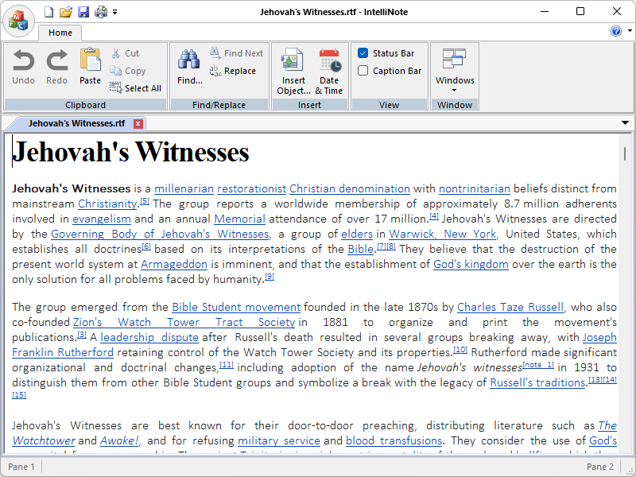

Download:
- [IntelliNoteSetup.msi](https://www.moga.doctor/freeware/IntelliNoteSetup.msi)
- [IntelliNote.zip](https://www.moga.doctor/freeware/IntelliNote.zip)

## Introduction

_IntelliNote_ is a free (as in “free speech” and also as in “free beer”) **R**ich**T**ext**F**ile editor. Running in the Microsoft Windows environment, its use is governed by [GNU General Public License v3.0](https://www.gnu.org/licenses/gpl-3.0.html). _IntelliNote_ is written in C++ and uses pure Win32 API and STL which ensures a higher execution speed and smaller program size. By optimizing as many routines as possible without losing user friendliness, _IntelliNote_ is trying to reduce the world carbon dioxide emissions. When using less CPU power, the PC can throttle down and reduce power consumption, resulting in a greener environment. I hope you enjoy _IntelliNote_ as much as I enjoy coding it!

### What is client-server application?

A client-server application is a program that runs on the client-side while accessing the information over a remote server. The client-server always makes requests to the remote server by calling functions of the server to retrieve information. The client program and the server program may run on different systems and on different platforms where they require a communications layer known as middleware.

The client-server application might run on a network client or a network server. The applications are solely described on their architecture except for the fact that how it is deployed on the network. It uses a two-tier architecture that has two users; the client and the server.

The server machine acts as a host that can run single or multiple server programs that share their resources with the clients. Sometimes the server gets overloaded when simultaneous requests are received from the client.

The communication between the client and server is a two-way street. Servers can reach the client to make sure that the client has appropriate updates, patches, or if there are any other requirements. Once the inquiry is done, the server closes the connection to the client so that the bandwidth space and the network are conserved.

### Features of client-server application

Some of the typical features of client-server applications are as follows:

- Multiple client programs have the ability to request services from a single server;
- A single client program can request services from multiple server programs;
- A single server program has the ability to provide multiple services;
- The client program doesn’t have to be aware of the number of subprograms that provide a service;
- Multiple subprograms have the ability to work together to provide a service;
- The server programs run on a machine that is remote from the machine that runs the client program.

## Getting started

### Install IntelliNote using the installer

- Download the installer
- Run the executable binary and follow the installation flow

The installer will likely require Administrative privileges in order to install _IntelliNote_ (and later, to update _IntelliNote_ or install or update plugins, or anything else that requires writing to the installation directory). If you do not have Administrative privileges, you either need to tell the installer to use a location where you do have write permission (though that may still ask for Administrator privileges), or you may choose not use the installer and instead run a portable edition from a directory where you have write permission.

### Install IntelliNote from zip

These instructions will allow you to run a portable or mini-portable (also called “minimalist”), without requiring administrative privileges.

- Create a new folder somewhere that you have write-permission
- Unzip the content into the new folder
- Run _IntelliNote_ from the new folder

The portable zip edition of _IntelliNote_ can be removed by deleting the directory they came in. If you manually set up file associations or context-menu entries in the OS, it is your responsibility to remove them yourself.

## Roadmap

This roadmap outlines where _IntelliNote_ is heading. It brings together the next steps for the features that are already there, ideas for new ones, and the maintenance work that goes into every release. Items are grouped by horizon rather than by date, and their order may change as feedback arrives or as the libraries _IntelliNote_ builds on evolve, so please treat it as a statement of intent, not a promise. For everything that has already shipped, see the [Release Notes](https://github.com/mihaimoga/IntelliNote/blob/main/ReleaseNotes.html).

_Last reviewed: November 2026 (version 0.01 in development)._

### Now (in progress and ongoing)

- **Version 0.01**: the first pre-release, with a tabbed editor for RTF notes, printing and print preview, embedded OLE objects, the `.rtf` file association (including an _Open with IntelliNote_ command in Windows Explorer) and the reopening of the saved notes that were open at the last close. It is meant for evaluation and early feedback, so it is not production-ready yet.
- **Up-to-date components**: each release picks up the latest genUp4win, PJ Naughter's CHLinkCtrl, CInstanceChecker and CVersionInfo.
- **Stability, security and performance**: bug fixes, security updates and performance tuning continue alongside new features, so that _IntelliNote_ stays fast and small.

### Next (planned, next in line)

- **Text formatting**: font, size, bold, italic, underline, strikethrough, text and highlight colors, alignment, lists and indentation on the ribbon. Notes are saved as RTF, which can carry all of this, but the ribbon has no formatting commands yet.
- **Check for updates**: a command that looks for a newer version through genUp4win. The library is part of the solution and of the installer, but nothing in the application calls it yet.
- **A useful status bar and zoom**: show the line and column, the word count and the zoom level, and add zoom commands to the View panel. The status bar still shows two placeholder panes today, and the caption bar shows the sample text of the project template.
- **Options dialog**: one place for the settings that cannot be changed today, such as reopening the previous notes at startup and registering or removing the `.rtf` association and the _Open with IntelliNote_ command. The Options button of the caption bar only customizes the ribbon.

### Later (planned, larger efforts)

- **Notebooks, sections and pages**: organize notes the way OneNote does, with a navigation pane next to the note. Today every note is a separate RTF file in its own tab.
- **Pictures, links and tables**: dedicated commands to insert pictures from files, hyperlinks and tables. The Insert panel only offers OLE objects and the date and time today.
- **Search across notes**: search, and optionally replace, across all the notes of a folder, with the matches listed in a results panel. Find and Replace work on the current note only today.
- **Windows Explorer integration**: finish the preview, thumbnail and search handlers so that notes can be previewed, shown as thumbnails and found by Windows Search. The IntelliNoteHandlers project is part of the solution, but its thumbnail drawing and search-content code is still the project template.
- **Fuller session restore**: reopen each note at its last caret and scroll position and, later, bring back unsaved and untitled notes. Today the session only remembers the file names of the notes that were saved to a file.

### Under consideration (ideas, not yet committed)

- **Spell checking**: underline misspelled words while typing, using the spell-checking support built into Windows.
- **Tags and to-do lists**: tag paragraphs and add check boxes, as in OneNote.
- **Synchronization between PCs**: keep notes up to date across several computers. _IntelliNote_ works on local files only today, and the repository has no server component.
- **Themes and dark mode**: choose a color theme for the ribbon and the editing area, including a dark one. There is no theme setting today.
- **Localized user interface**: translated menus, commands and messages (the interface is English only today, and the Date & Time command always writes English day and month names).
- **Native ARM64 and high-DPI support**: a native ARM64 build for Windows on Arm devices (_IntelliNote_ is currently built for x86 and x64) and Per-Monitor V2 DPI awareness for a sharper interface on high-DPI and mixed-DPI displays.
- **Automated builds**: a GitHub Actions workflow that builds the Win32 and x64 configurations for every pull request, so that contributions get quick feedback.

### Help shape the roadmap

Want to see something sooner, or have an idea that is not listed here? [Open an issue](https://github.com/mihaimoga/IntelliNote/issues) or start a conversation in [Discussions](https://github.com/mihaimoga/IntelliNote/discussions). Contributions are welcome as well: any item above can be picked up through a pull request, as described in the next section. For enhancements, the issue must be approved by a project administrator (it will carry the `Accepted` label) before the pull request can be merged, so it is best to open the issue before you start coding.

## Create and Submit your Pull Request

As noted in the [Contributing Rules](https://github.com/mihaimoga/IntelliNote/blob/main/CONTRIBUTING.md) for _IntelliNote_, all Pull Requests need to be attached to a issue on GitHub. So the first step is to create an issue which requests that the functionality be improved (if it was already there) or added (if it was not yet there); in your issue, be sure to explain that you have the functionality definition ready, and will be submitting a Pull Request. The second step is to use the GitHub interface to create the Pull Request from your fork into the main repository. The final step is to wait for and respond to feedback from the developers as needed, until such time as your PR is accepted or rejected.

## Acknowledges

This open source project uses the following libraries:

- Stefan-Mihai MOGA's [genUp4win](https://github.com/mihaimoga/genUp4win)
- PJ Naughter's [CHLinkCtrl](https://www.naughter.com/hlinkctrl.html)
- PJ Naughter's [CInstanceChecker](https://www.naughter.com/sinstance.html)
- PJ Naughter's [CVersionInfo](https://www.naughter.com/versioninfo.html)
